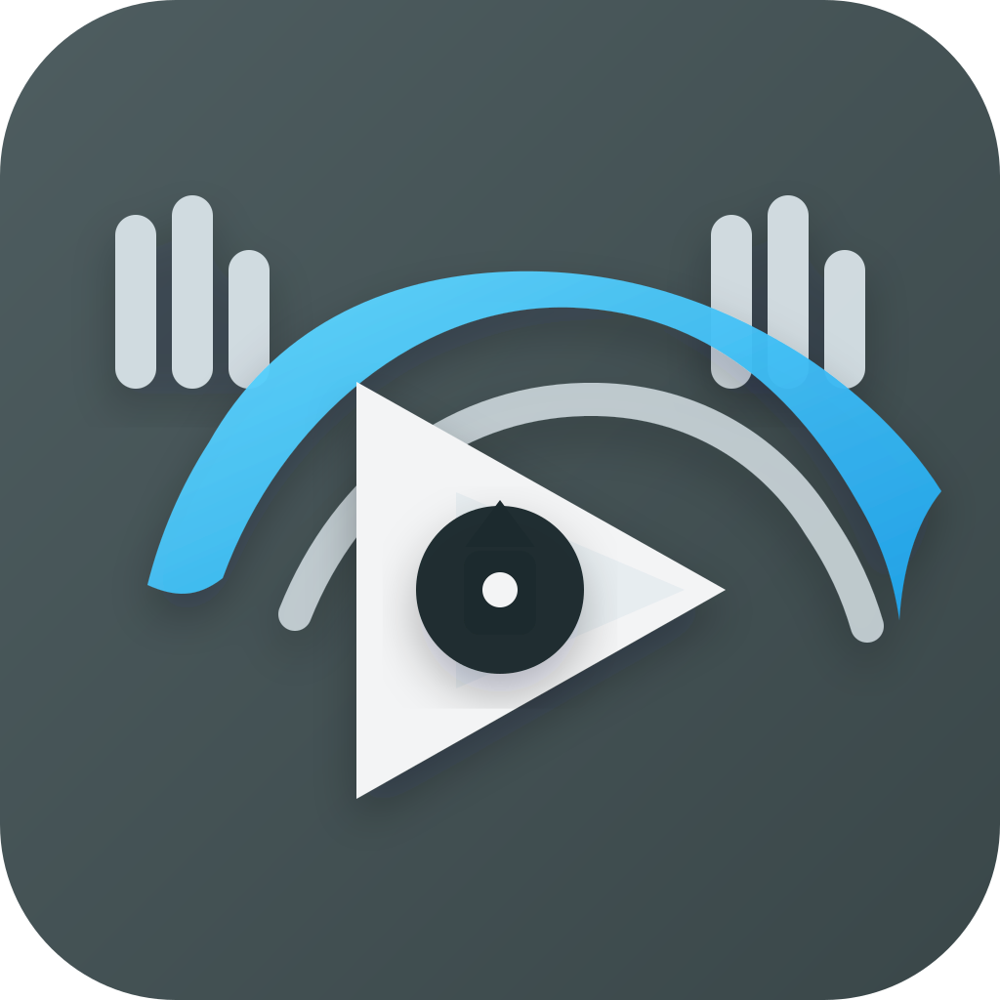

# T2Rhythm

**한국 음악에 맞춘, 온디바이스 개인 음악 앱**

내 음악을 듣고, 정보를 채우고, 오래 보관하고, 나의 청취 기록으로 다음 곡을 발견하세요.

[**최신 APK 다운로드**](https://github.com/tak2-08/T2Rhythm/releases/latest) · [사용 안내](docs/PERSONAL_MUSIC_ARCHIVE.md) · [문제 제보](https://github.com/tak2-08/T2Rhythm/issues)

